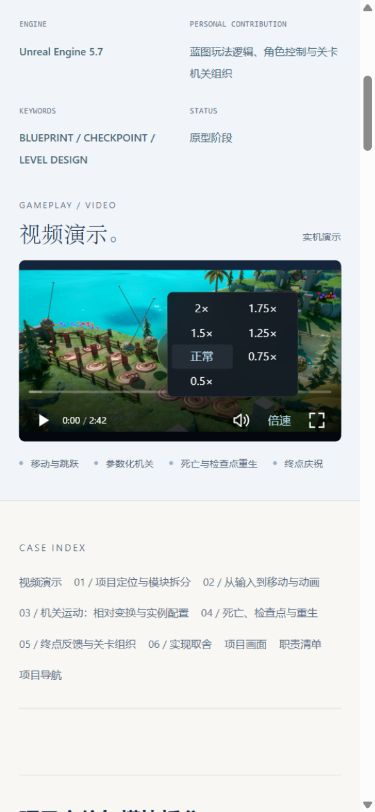
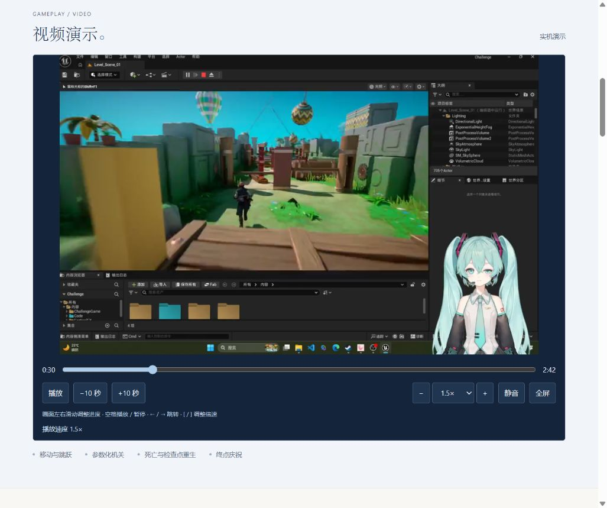
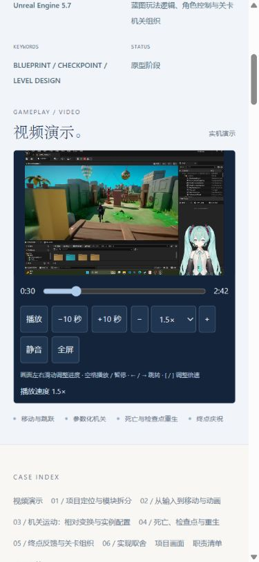

# Challenge 视频更新与播放器验证

验证日期：2026-10-13。使用本地 Astro 静态预览和 Codex 内置 Chromium 浏览器。

## 当前版本：画面内浮层控件

根据用户对第一版界面的反馈，播放器改为画面底部的渐变浮层。左侧为播放图标和时间，右侧为音量、倍速和全屏。进度条使用细线、缓冲进度与悬停时间提示；去掉常驻的跳转按钮、加减速按钮和快捷键说明。暂停时显示居中播放入口和底栏，播放后 2.4 秒自动淡出；移动鼠标、操作键盘或暂停后恢复。

倍速在上方菜单选择 0.5×～2×，当前项高亮。音量按钮展开音量滑条和静音操作。小屏幕使用两列倍速菜单，避免视频区域较矮时菜单被裁切。

第二次浏览器验证：

- 菜单选择 1.5×、2×、0.5×，实际 `video.playbackRate` 对应变化。
- 音量设为 0.4 后，由视频 volumechange 回写的滑条读数为 40%。
- 播放后 `data-controls-visible` 自动变为 false，画面中控件隐藏；空格暂停后恢复。
- 390px 视口中拖动画面，实际进度从 40 秒变为 56.14 秒，保持暂停状态。
- Escape 关闭倍速菜单，`aria-expanded` 变为 false。
- 390px 和 320px 宽度下主要控件保持一行，倍速选项完整显示。
- 全屏与退出全屏正常，浮层仍贴在画面底部。
- 浏览器没有 warning/error 日志；类型检查、构建和 325 项静态检查通过。




## 视频更新

- 源文件：`media-source/challenge/Challenge.mp4`，202,032,388 字节。
- 发布文件：`public/media/projects/challenge/demo.mp4`，25,127,341 字节（23.963 MiB）。
- 输出：1152 × 720、30 fps、H.264 / yuv420p、AAC，时长 162.656009 秒。
- 两遍编码，保留完整视频及声音，启用 MP4 faststart。
- ffprobe 校验尺寸、时长和编码；ffmpeg 完整解码通过。
- 原压缩版保存在 `media-source/.work/2026-10-13T10-35-25-313Z/challenge-demo.mp4.previous`。
- 新源文件保留原位置；压缩报告合并保留其他项目记录。

后续替换源文件后运行：

```powershell
node scripts/optimize-media.mjs --project=challenge --replace
```

脚本先编码和验证临时文件，再备份已有发布文件并替换。省略 `--replace` 会保护现有输出。

## 第一版浏览器交互验证记录

| 操作 | 实测结果 |
| --- | --- |
| 加速按钮 | video.playbackRate 从 1 变为 1.25 |
| 倍速选择 | 选择 0.5，实际 playbackRate 为 0.5；视频正常播放 |
| 速度边界 | 0.5× 时禁用减速，2× 时禁用加速 |
| 快进按钮 | currentTime 从 0 跳到 10 秒 |
| 进度条 | 设置 80 秒后，实际 currentTime 为 80 |
| 暂停时画面向右拖动 | currentTime 从 84.04 跳到 103.75 秒，保持暂停 |
| 播放时画面向左拖动 | currentTime 从 30.20 跳到 3.41 秒，松开后继续播放 |
| 键盘左箭头 / 左方括号 | 退后 5 秒；倍速从 2 变为 1.75 |
| 全屏 / 退出全屏 | 视频和自定义控件一起进入全屏，退出按钮正常工作 |
| 390 × 844 响应式视口 | 控件正常换行；进度条和倍速可操作 |
| FPS 共用播放器 | 快进到 10 秒、倍速 1.5，媒体加载正常 |
| BoardLine 共用播放器 | 快进到 10 秒、倍速 1.25，媒体加载正常；无浏览器 warning/error 日志 |

移动布局及拖动操作在桌面 Chromium 响应式视口验证；没有进行实体手机或 iOS Safari 实机验证。

## 项目检查

- `pnpm check`：0 errors、0 warnings、0 hints。
- `pnpm build`：通过。依赖 zod 的两条 Rollup 注释告警不影响构建。
- `node scripts/verify-build.mjs`：325 / 325 通过，包括发布文件体积、播放器标记和原生控件降级检查。
- `git diff --check`：通过。

## 第一版截图记录




